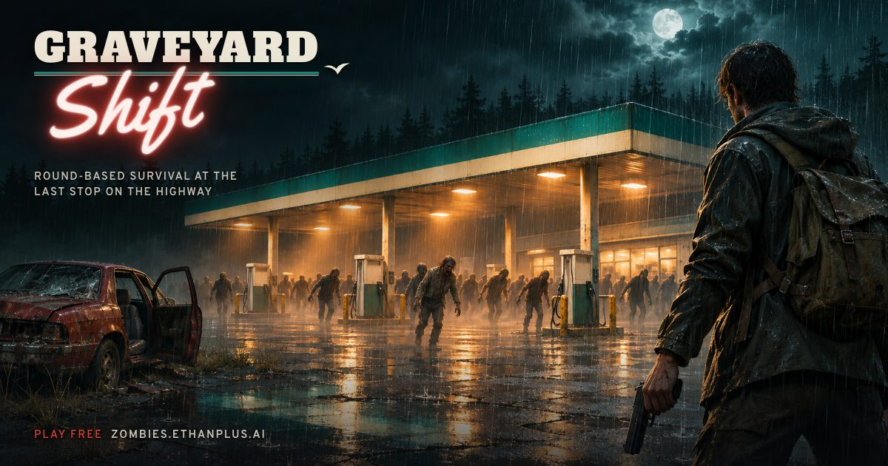

# Graveyard Shift

A round-based zombies shooter that runs in the browser. You hold out at a roadside diner and gas station
through the night: board up windows, earn points for every hit and kill, open new areas, buy weapons off
the wall, search for loot and get the power back on, while each round sends more and tougher zombies.
It plays with mouse and keyboard on a desktop and with touch controls on a phone.



Play it: https://zombies.ethanplus.ai

## How it works

- Rendered with [three.js](https://threejs.org) on WebGL2, with graphics tiers that adapt to the device.
- Everything is generated in code when the page loads: models, textures, animation and the synthesised
  audio. The only image files are the key art for the loading screen and the link preview.
- esbuild bundles the game into a single self-contained HTML file, `dist/index.html`, which runs from
  any static host or straight from disk.
- The leaderboard and the "Report a problem" form are optional. They talk to a small Cloudflare Worker
  with a D1 database in [`server/`](server/README.md), and are switched off unless the build is
  configured for them (see Configuration).

## Running it

Needs Node.js 22 or later.

```sh
git clone https://github.com/ethanplusai/zombies.git
cd zombies
npm install
npm run build        # writes dist/index.html
```

Open `dist/index.html` in a browser. `npm run dev` rebuilds on every change.

Tests:

```sh
npm test
```

The smoke and screenshot scripts (`npm run smoke`, `npm run smoke:mobile`, `npm run shot`) drive the built
game in a headless browser and need Playwright's Chromium once:

```sh
npx playwright install chromium
```

## Project layout

| Folder | What is in it |
| --- | --- |
| `src/audio/` | Synthesised sound effects, voices, ambience and music |
| `src/core/` | Game loop, events, device detection, storage, seeded randomness, URL parameters |
| `src/fx/` | Particles, blood, decals, muzzle flashes, fire and other effects |
| `src/game/` | Rules: rounds, economy, purchases, power-ups, loot, machines, tuning values |
| `src/level/` | The map: layout, buildings, props, vehicles, collision |
| `src/mats/` | Procedural materials and textures |
| `src/nav/` | Navigation grid and flow fields for zombie pathing |
| `src/net/` | Leaderboard and report clients for the optional backend |
| `src/player/` | Player movement, view, input, touch controls and the test bot |
| `src/render/` | Renderer, lighting, shadows, sky, post-processing and quality tiers |
| `src/ui/` | Menus, HUD, loading screen, hints, end screen, leaderboard and report screens |
| `src/weapon/` | Weapons: models, animation, firing and the first-person view |
| `src/zombie/` | Zombie bodies, animation, AI and spawning |
| `server/` | The optional Cloudflare Worker for the leaderboard and reports |
| `scripts/` | Build, smoke-test, screenshot and benchmarking scripts |
| `tests/` | Vitest unit tests |

## Configuration

The online features are configured at build time from two environment variables, documented in
[`.env.example`](.env.example):

- `GS_API_BASE`: the URL of your deployed Worker from `server/`.
- `GS_ALLOWED_ORIGINS`: a comma list of the origins the game is served from.

Without both, the game builds with the leaderboard and report form switched off and makes no requests
to any API. To run your own backend, follow [`server/README.md`](server/README.md).

## Credits

Built by Fable 5.2, prompted by [Ethan](https://x.com/ethanplusai).

## Licence

[MIT](LICENSE)
